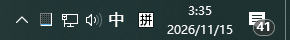
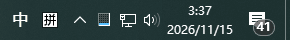

ENG | [中文](doc/README_cn.md) | [日本語](doc/README_ja.md)

# IME Tray Icon Fix

In a multilingual input environment on Windows 10 / 11, the **Input Indicator** in the system tray toggles its width between "1 glyph" and "2 glyphs". Because the notification area is **anchored to the right edge**, this width change shifts the tray icons that sit to the left of the indicator. When "**Let me set a different input method for each app window**" is enabled, clicking a tray icon can end up hitting **a neighboring icon instead** (a misclick).



---

## The Problem: Why the Misclick Happens

The default notification area layout (left to right, anchored to the right edge):

```text
  Screen Left  <-----------------------------------------------------  Screen Right Edge
  [Chevron ^]  |  [SysPager (Tray Icons)]  |  [IME Indicator]  |  [Clock]  |  [Show Desktop]
```

Notice that the **Input Indicator sits right in the middle** - to its left are the tray icons (SysPager), to its right is the clock. When **"Let me set a different input method for each app window"** is enabled in a multilingual setup (e.g., English, Chinese, Japanese):

1. While typing in an app, the indicator often displays **2 glyphs** (e.g., `CH` + `中` or `JP` + `あ`), occupying a wider slot.
2. When you click a tray icon (such as Steam or WiFi), `WM_LBUTTONDOWN` immediately shifts focus to `explorer.exe`.
3. The shell defaults to English, shrinking the indicator down to **1 glyph** (`ENG`).
4. Because the clock on the right is pinned to the right edge, the shrunk width forces **everything to the left of the indicator (`SysPager` and `Chevron ^`) to slide rightward**.
5. When `WM_LBUTTONUP` fires, the icon you aimed at has moved, and your click lands on whichever neighboring icon slid under your cursor.

---

## The Fix

The core idea is simple: **move the Input Indicator to the first slot of the notification area**. Everything else then sits to its right, at a fixed distance from the right screen edge, so no matter how the indicator's width changes, nothing gets pushed around.



The fixed layout:

```text
[IME Indicator]  |  [Chevron ^]  |  [SysPager (Tray Icons)]  |  [Clock]  |  [Show Desktop]
```

##### Mimicking Docked Language Bar?

Yes. But this feature is already broken in Win10, and has been completely removed in Win11:

- **Unstable state in Windows 10**: The feature sometimes reverts to a disabled language bar state for various inexplicable reasons.
  - **Remote Desktop (RDP)**: Remote Desktop is completely unsupported. It inevitably reverts to the disabled language bar state - even if both sides have this setting enabled.
- **Unsupported by the new IME**: The new version of Microsoft Pinyin itself does not support docking the language bar, unless you manually enable "Use previous version of Microsoft Pinyin".
- **Completely removed in Windows 11**: Underlying interfaces such as DeskBand have been completely removed by Microsoft, making native docking impossible to use.

---

## Windhawk Mod

[Windhawk](https://windhawk.net) is an open-source Windows customization tool. Mods are distributed as `.wh.cpp` source files, and Windhawk compiles and injects them.

The two systems implement the system tray completely differently (Windows 10 uses an imperative, stateless Win32 window relayout; Windows 11 uses declarative XAML, changing a dependency property and letting the framework relayout). Therefore the solution is split into two independent mods that share no code.

| Item | Windows 10 | Windows 11 |
| --- | --- | --- |
| Source file | `win10-ime-tray-icon-fix.wh.cpp` | `win11-ime-tray-icon-fix.wh.cpp` |
| Tech stack | Pure Win32 (HWND / window subclassing) | XAML (WinRT) |
| Mod ID | `win10-ime-tray-icon-fix` | `win11-ime-tray-icon-fix` |
| Tested on | 21H2 (Build 19044) | 24H2 LTSC / 26H2 |
| User settings | See below (3 modes) | None (toggle only) |

### Windows 10 Mod

Offers three modes, which can be enabled individually or in combination:

- **Mode 1: Move to the leftmost (recommended)** - puts the indicator in the first slot of the notification area; everything that used to sit left of it shifts right, and the icons to its right no longer move.
- **Mode 2: Fixed width** - forces the indicator to always occupy a fixed pixel width. 36 for one glyph, 58 for one glyph plus the secondary icon; 0 hides it completely.
- **Mode 3: Hide the secondary input indicator icon** - hides the "中/英" or "あ/Ａ" button inside the indicator.

> Tested on Windows 10 21H2. Windows 10 20H2 and above (including LTSC 2021, Builds 19042–19045) share the exact same binary codebase, so it should work flawlessly. Earlier builds (1903/1909 and prior) should theoretically work as well, but remain untested.

### Windows 11 Mod

Does exactly one thing: puts the indicator in the first slot of the notification area, with **no user settings at all**, controlled only by the mod toggle.

- Width / spacing: handled by the official mod "Taskbar height and icon size".
- Hiding the IME secondary icon: handled by the official mod "Taskbar tray system icon tweaks".

> `SystemTrayFrameGrid` can be a `Grid` or a `StackPanel`. Verified on Windows 11 24H2 LTSC (`Grid`) and 26H2 (`StackPanel`). Other versions should work as the mechanism is identical and the Windhawk should handle the injection properly, remain untested though.

### AI Contribution Statement

The reverse engineering and the source code were completed by an AI agent. The final mod products, however, were guided and audited by the author to make sure no unnecessary extra performance overhead was introduced (the AI had previously introduced a repeating timers or an extra thread). For the Windows 10 mod, the author verified and confirmed both the tech stack and the concrete implementation. For the Windows 11 mod, the author only audited and ruled out the extra performance overhead, because the author did not bother to study the XAML details.

The rendering GIF animation is produced by an AI Agent, this is what the author is absolutely unwilling to do without an AI Agent :).